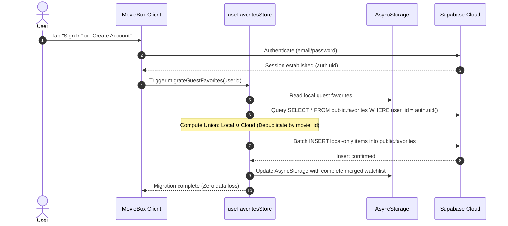
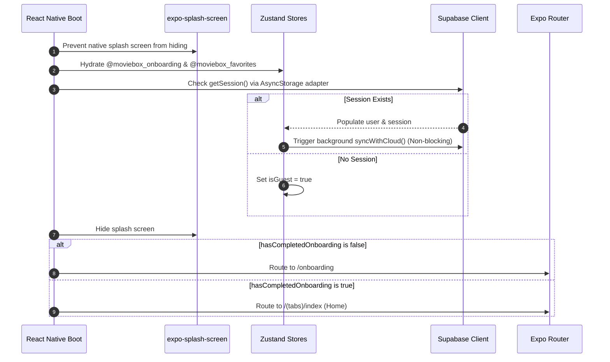

# Austin MovieBox — System Architecture (`architecture.md`)

> **Document**: Technical Architecture, Navigation Hierarchy, State Engine & Service Layer  
> **Application**: Austin MovieBox (MovieBox MVP)  
> **Version**: 1.0.0  
> **Status**: Approved & Specified  

---

## 1. System Overview & Technology Stack

Austin MovieBox is engineered on a modern universal React Native stack leveraging the latest Expo SDK capabilities:

| Architecture Layer | Technology | Version | Architectural Responsibility |
| :--- | :--- | :--- | :--- |
| **Universal Runtime** | React Native / Expo | Expo 57 / RN 0.86 | Universal cross-platform engine (iOS, Android, Web) |
| **Routing & Navigation**| Expo Router | ~57.0.24 | File-system-based deep-linkable native stack & tabs |
| **Styling & Theming** | NativeWind / Tailwind | 4.2.7 / 3.4.19 | Utility-first styling compiled to high-speed native style objects |
| **State Management** | Zustand | ^5.0.15 | Lightweight decoupled reactive stores with async hydration |
| **Offline Persistence** | AsyncStorage | 2.2.0 | Durable local key-value storage engine |
| **Cloud Backend & Auth**| Supabase JS | ^2.117.2 | GoTrue authentication, PostgreSQL database, Row Level Security |
| **Image Rendering** | `expo-image` | ~57.0.5 | Native image component with blurhash placeholders & memory cache |
| **Iconography** | Vector Icons / Symbols | ~15.0.2 | Native SF Symbols on iOS, Ionicons on Android/Web |

---

## 2. Directory Structure & Code Organization

```
AustinMovieBox/
├── docs/                        # Complete project documentation hub
│   ├── product.md               # Product vision, audience & value propositions
│   ├── scope.md                 # Functional MVP boundaries & non-goals
│   ├── user-flows.md            # Interaction flows & transition sequences
│   ├── screens.md               # Comprehensive screen inventory & UI states
│   ├── design-system.md         # Thematic design tokens, typography & components
│   ├── data-model.md            # Domain models, AsyncStorage & Supabase schemas
│   ├── architecture.md          # Technical architecture & subsystem flows (this doc)
│   └── implementation-plan.md   # Phased roadmap, task checklist & QA verification
├── src/
│   ├── app/                     # Expo Router file-based screens
│   │   ├── _layout.tsx          # Root Stack (Theme, session bootstrap, modals)
│   │   ├── index.tsx            # Initial route redirector
│   │   ├── onboarding.tsx       # 3-slide onboarding carousel
│   │   ├── auth.tsx             # Sign In / Sign Up modal sheet
│   │   ├── (tabs)/              # Persistent bottom tab navigator
│   │   │   ├── _layout.tsx      # Tab bar styling & iconography
│   │   │   ├── index.tsx        # Home / Discover feed
│   │   │   ├── search.tsx       # Live search & genre filters
│   │   │   ├── favorites.tsx    # Watchlist hub & guest sync banner
│   │   │   └── profile.tsx      # User profile, stats & session controls
│   │   └── movie/
│   │       └── [id].tsx         # Dynamic Movie Details screen
│   ├── components/              # Modular UI components
│   │   ├── movie-card.tsx       # 2:3 aspect ratio poster card
│   │   ├── movie-hero.tsx       # Featured backdrop hero banner
│   │   ├── movie-rail.tsx       # Horizontal scrolling rail
│   │   ├── favorite-button.tsx  # Animated heart toggle button
│   │   ├── sync-banner.tsx      # Guest sync prompt banner
│   │   └── empty-state.tsx      # Actionable zero-state view
│   ├── data/
│   │   └── movies.ts            # High-fidelity curated catalog
│   ├── services/
│   │   ├── supabase.ts          # Supabase client singleton & offline fallback
│   │   └── cloud-sync.ts        # Non-destructive union merge engine
│   ├── stores/
│   │   ├── onboarding-store.ts  # Onboarding state & completion persistence
│   │   ├── auth-store.ts        # Auth session & guest mode state
│   │   └── favorites-store.ts   # Favorites store with local & cloud sync
│   ├── theme/
│   │   ├── tokens.ts            # Design tokens (colors, font, radii, grid)
│   │   └── index.ts             # Theme exports & styling helpers
│   └── types/
│       └── index.ts             # TypeScript domain interfaces
├── tailwind.config.js           # NativeWind v4 theme configuration
└── package.json                 # Project dependencies & scripts
```

---

## 3. Navigation Hierarchy (Expo Router)

```mermaid
flowchart TD
    RootStack[_layout.tsx Root Stack]
    RootStack --> Onboarding[onboarding.tsx Fullscreen]
    RootStack --> Auth[auth.tsx Modal Sheet]
    RootStack --> MovieDetail[movie/[id].tsx Modal/Screen]
    RootStack --> Tabs[(tabs)/_layout.tsx Bottom Tabs]

    Tabs --> TabHome[Home /(tabs)/index]
    Tabs --> TabSearch[Search /(tabs)/search]
    Tabs --> TabFavorites[Favorites /(tabs)/favorites]
    Tabs --> TabProfile[Profile /(tabs)/profile]

    TabHome -.-> MovieDetail
    TabSearch -.-> MovieDetail
    TabFavorites -.-> MovieDetail
    TabFavorites -.-> Auth
    TabProfile -.-> Auth
```

### Route Behavior Rules
- `_layout.tsx`: Configured with dark theme headers hidden (`headerShown: false`) and transparent modal presentations (`presentation: 'modal'` for `/auth`).
- `(tabs)/_layout.tsx`: Renders persistent bottom tab bar across all 4 top-level destinations. Tab bar styled with `#141923` surface, `#202736` top border, active tint `#E50914`, and inactive tint `#6B7280`.

---

## 4. State Management Architecture (Zustand 5)

State is organized into clean, single-responsibility Zustand stores:

```mermaid
flowchart LR
    subgraph Client State (Zustand 5)
        OS[useOnboardingStore]
        AS[useAuthStore]
        FS[useFavoritesStore]
    end

    subgraph Local Device Storage
        ASync1[AsyncStorage: @moviebox_onboarding]
        ASync2[AsyncStorage: @moviebox_favorites]
        ASync3[AsyncStorage: @moviebox_auth]
    end

    subgraph Supabase Cloud
        SupaAuth[Supabase GoTrue Auth]
        SupaDB[(PostgreSQL: public.favorites)]
    end

    OS <--> ASync1
    FS <--> ASync2
    AS <--> ASync3
    AS <--> SupaAuth
    FS <--> SupaDB
```

### Store Responsibilities
1. **`useOnboardingStore`**:
   - `hasCompletedOnboarding: boolean`
   - `completeOnboarding()`: Writes `true` and saves to `@moviebox_onboarding`.
   - `resetOnboarding()`: Resets flag for development or testing.
2. **`useAuthStore`**:
   - `user: UserProfile | null`, `session: any | null`, `isGuest: boolean`, `isLoading: boolean`
   - Actions: `signIn(email, password)`, `signUp(email, password)`, `signOut()`, `continueAsGuest()`, `initializeAuth()`.
3. **`useFavoritesStore`**:
   - `favorites: Movie[]`, `isHydrated: boolean`, `isSyncing: boolean`
   - `isFavorite(id)`: $O(1)$ constant-time lookup.
   - `toggleFavorite(movie)`: Optimistic local update with background cloud sync.
   - `syncWithCloud(userId)`: Reads remote records and reconciles with local store.
   - `migrateGuestFavorites(userId)`: Runs non-destructive union merge.

---

## 5. Non-Destructive Cloud Migration Sequence



---

## 6. App Startup Sequence

The application boot lifecycle follows a deterministic sequence:



---

## 7. Resilience & Fallback Strategy

1. **Unconfigured Supabase Keys**:
   - If `EXPO_PUBLIC_SUPABASE_URL` or `EXPO_PUBLIC_SUPABASE_ANON_KEY` are missing from `.env`, `src/services/supabase.ts` initializes in **Offline Guest Mode**.
   - Zero crashes; the app functions 100% locally with AsyncStorage.
2. **Network Offline Handling**:
   - The catalog, movie details, search engine, and local favorites remain fully operational offline.
   - Profile and Favorites tabs display non-intrusive offline status badges.
