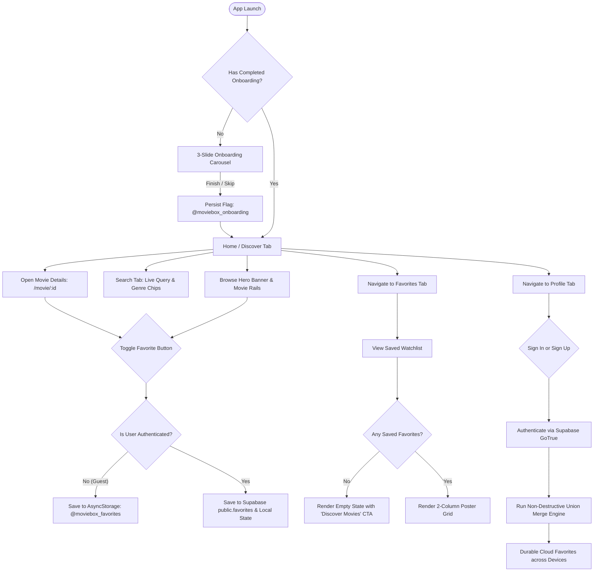
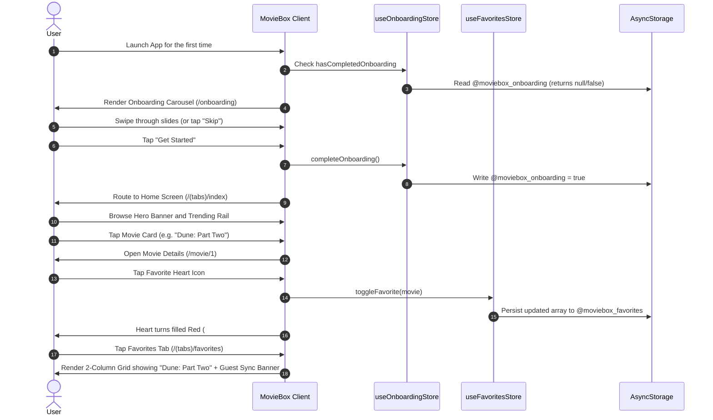
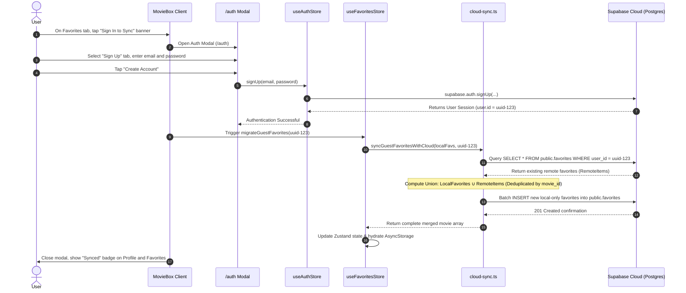
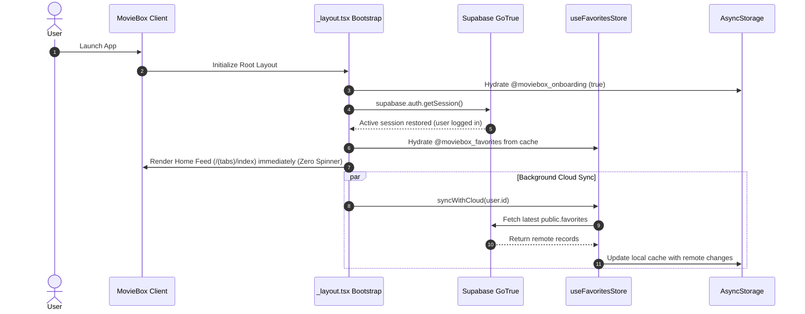
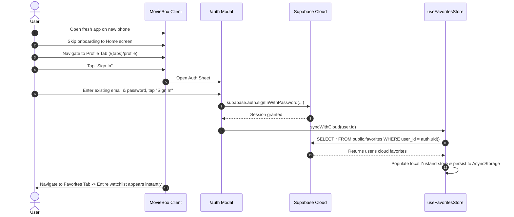
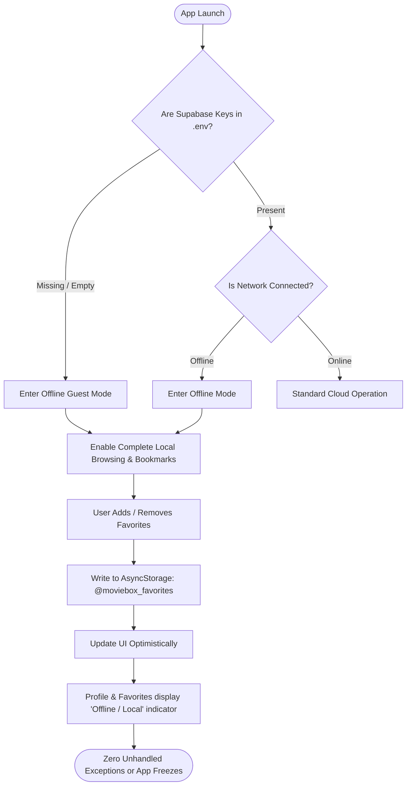

# Austin MovieBox — User Flows & Interaction Sequences (`user-flows.md`)

> **Document**: End-to-End User Journeys, Transition Logic & Interaction State Diagrams  
> **Application**: Austin MovieBox (MovieBox MVP)  
> **Version**: 1.0.0  
> **Status**: Approved & Specified  

---

## 1. Master System Flow Diagram

The complete navigation and operational logic across guest and authenticated lifecycle states is mapped below:



---

## 2. Flow 1: First-Time Guest Discovery & Local Bookmarking

This is the primary frictionless entry path for a brand new user who has just downloaded the app.



### Key Experience Highlights
- **Zero Interruption**: No email prompts, phone verification, or password setup.
- **Immediate Feedback**: Heart button illuminates within 16ms (single frame).
- **Persistent Storage**: Force-closing the app at this point preserves the saved favorite.

---

## 3. Flow 2: Guest-to-Account Cloud Migration (Non-Destructive Merge)

When a guest user who has accumulated local favorites decides to sign in or create an account, their local items are preserved and merged with cloud data.



### Non-Destructive Invariants
1. **Never Overwrite**: Remote items present in Supabase are never deleted during registration.
2. **Never Discard**: Local guest items are never discarded; they are uploaded and unioned.
3. **Rollback Resilience**: If network drops during upload, local items remain cached on device.

---

## 4. Flow 3: Returning Authenticated User Startup

When an existing registered user opens the application on their primary device.



### Key Experience Highlights
- **Instant Boot**: Screen renders immediately using local AsyncStorage cache without waiting for remote network roundtrips.
- **Background Sync**: Fresh favorites synchronization occurs silently in the background.

---

## 5. Flow 4: Sign-In From a New / Secondary Device

When an authenticated user installs MovieBox on a second phone or tablet.



---

## 6. Flow 5: Search & Genre Filtering Engine

How users search, filter by genre, and handle empty states.

```mermaid
sequenceDiagram
    autonumber
    actor User
    participant SearchScreen as search.tsx
    participant Catalog as movies.ts
    participant Details as /movie/:id

    User->>SearchScreen: Tap Search Tab (/(tabs)/search)
    SearchScreen->>User: Display search input, genre chips, and full movie grid
    User->>SearchScreen: Tap genre chip "Sci-Fi"
    SearchScreen->>SearchScreen: Filter catalog by genre === "Sci-Fi"
    SearchScreen->>User: Grid updates dynamically showing Sci-Fi titles
    User->>SearchScreen: Type query "Dune" in search bar
    SearchScreen->>SearchScreen: Filter catalog by (title.includes("Dune") && genre === "Sci-Fi")
    SearchScreen->>User: Grid narrows to "Dune: Part Two"
    User->>SearchScreen: Type query "Unicorn" (No match)
    SearchScreen->>User: Render No Results state with "Clear Filters" CTA
    User->>SearchScreen: Tap "Clear Filters"
    SearchScreen->>SearchScreen: Reset query to "" and genre to "All"
    SearchScreen->>User: Full catalog restored
    User->>SearchScreen: Tap movie card
    SearchScreen->>Details: Navigate to /movie/:id
```

---

## 7. Flow 6: Offline Resilience & Graceful Fallback

How the application behaves when disconnected from the internet or running without Supabase credentials.


