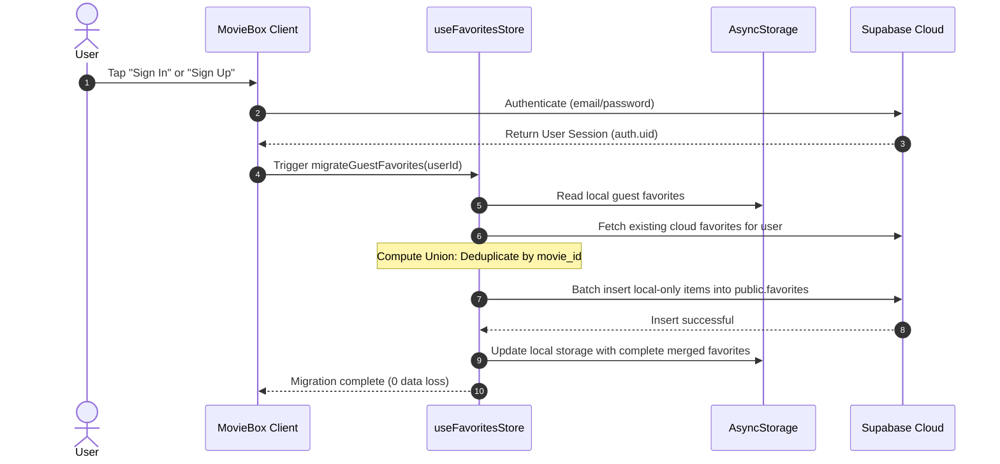

# MovieBox — Technical Architecture (`ARCHITECTURE.md`)

## 1. System Overview & Technology Stack

| Layer | Technology | Version | Purpose |
| :--- | :--- | :--- | :--- |
| **Framework** | Expo SDK / React Native | Expo 57 / RN 0.86 | Universal cross-platform runtime |
| **Navigation** | Expo Router | ~57.0.24 | File-system-based deep-linkable routing |
| **Styling** | NativeWind / Tailwind CSS | 4.2.7 / 3.4.19 | Utility-first styling with dark cinema palette |
| **State Management**| Zustand | ^5.0.15 | Decoupled client state with AsyncStorage hydration |
| **Persistence** | `@react-native-async-storage/async-storage` | 2.2.0 | Local-first offline storage |
| **Backend & Auth** | Supabase JS Client | ^2.117.2 | PostgreSQL, GoTrue Auth, Row Level Security |
| **Image Loading** | `expo-image` | ~57.0.5 | High-performance cached image rendering with crossfade |
| **Vector Icons** | `@expo/vector-icons` / `expo-symbols` | ~15.0.2 | Native iOS SF Symbols & Material/Ionicons |

---

## 2. Directory Structure

```
austinemoviebox/
├── implementation/              # Implementation docs & roadmap
│   ├── README.md                # Implementation hub index
│   ├── PLAN.md                  # Phased bounded-task plan
│   ├── ARCHITECTURE.md          # Technical architecture (this doc)
│   ├── TASKS.md                 # Granular checklist & verification status
│   ├── DATABASE.md              # Supabase schema & RLS rules
│   └── TESTING.md               # QA test suite and acceptance matrix
├── src/
│   ├── app/                     # Expo Router file-based screens
│   │   ├── _layout.tsx          # Root Stack (Splash, Theme, Session Boot)
│   │   ├── index.tsx            # Initial route redirector
│   │   ├── onboarding.tsx       # 3-slide Onboarding Carousel
│   │   ├── auth.tsx             # Sign In / Sign Up Modal
│   │   ├── (tabs)/              # Bottom Tab Navigator
│   │   │   ├── _layout.tsx      # Tab Bar configuration & Icons
│   │   │   ├── index.tsx        # Discover / Home Feed
│   │   │   ├── search.tsx       # Search & Genre Filter
│   │   │   ├── favorites.tsx    # Favorites Watchlist Hub
│   │   │   └── profile.tsx      # User Profile & Session Manager
│   │   └── movie/
│   │       └── [id].tsx         # Dynamic Movie Details Screen
│   ├── components/              # Modular UI components
│   │   ├── movie-card.tsx       # 2:3 aspect ratio poster card
│   │   ├── movie-hero.tsx       # Featured backdrop hero banner
│   │   ├── movie-rail.tsx       # Horizontal scrolling rail
│   │   ├── favorite-button.tsx  # Animated heart toggle
│   │   ├── sync-banner.tsx      # Guest migration prompt banner
│   │   └── empty-state.tsx      # Actionable zero-state view
│   ├── data/
│   │   └── movies.ts            # Curated catalog database
│   ├── services/
│   │   ├── supabase.ts          # Supabase client & fallback provider
│   │   └── cloud-sync.ts        # Non-destructive union merge engine
│   ├── stores/
│   │   ├── onboarding-store.ts  # Onboarding state & completion flag
│   │   ├── auth-store.ts        # Auth session & guest status
│   │   └── favorites-store.ts   # Favorites store with local & cloud sync
│   ├── theme/
│   │   ├── tokens.ts            # Design tokens (colors, font, radii, grid)
│   │   └── index.ts             # Theme exports & styling helpers
│   └── types/
│       └── index.ts             # TypeScript interfaces (Movie, User, etc.)
```

---

## 3. Navigation Hierarchy (Expo Router)

```mermaid
flowchart TD
    RootStack[_layout.tsx Root Stack]
    RootStack --> Onboarding[onboarding.tsx]
    RootStack --> Auth[auth.tsx Modal]
    RootStack --> MovieDetail[movie/[id].tsx Modal/Screen]
    RootStack --> Tabs[(tabs)/_layout.tsx]

    Tabs --> TabHome[Home /(tabs)/index]
    Tabs --> TabSearch[Search /(tabs)/search]
    Tabs --> TabFavorites[Favorites /(tabs)/favorites]
    Tabs --> TabProfile[Profile /(tabs)/profile]

    TabHome -.-> MovieDetail
    TabSearch -.-> MovieDetail
    TabFavorites -.-> MovieDetail
    TabFavorites -.-> Auth
    TabProfile -.-> Auth
```

---

## 4. State Management Architecture

```mermaid
flowchart LR
    subgraph Client State (Zustand)
        OS[useOnboardingStore]
        AS[useAuthStore]
        FS[useFavoritesStore]
    end

    subgraph Local Storage
        ASync1[AsyncStorage: @moviebox_onboarding]
        ASync2[AsyncStorage: @moviebox_favorites]
        ASync3[AsyncStorage: @moviebox_auth]
    end

    subgraph Cloud Storage
        SupaAuth[Supabase Auth / GoTrue]
        SupaDB[(Supabase Postgres: favorites)]
    end

    OS <--> ASync1
    FS <--> ASync2
    AS <--> ASync3
    AS <--> SupaAuth
    FS <--> SupaDB
```

### Store Responsibilities

1. **`useOnboardingStore`**:
   - `hasCompletedOnboarding: boolean`
   - `completeOnboarding()`: Sets flag and persists to `@moviebox_onboarding`.
   - `resetOnboarding()`: Resets flag for testing.

2. **`useAuthStore`**:
   - `user: UserProfile | null`
   - `session: Session | null`
   - `isGuest: boolean`
   - `isLoading: boolean`
   - Methods: `signIn()`, `signUp()`, `signOut()`, `continueAsGuest()`, `initializeAuth()`.

3. **`useFavoritesStore`**:
   - `favorites: Movie[]`
   - `isHydrated: boolean`
   - `isSyncing: boolean`
   - Methods:
     - `isFavorite(movieId)`: Constant-time lookup.
     - `toggleFavorite(movie)`: Adds or removes movie locally and triggers background cloud update if signed in.
     - `syncWithCloud(userId)`: Fetches remote items and updates local cache.
     - `migrateGuestFavorites(userId)`: Computes union set ($Local \cup Cloud$) and pushes guest items to Supabase without duplicates.

---

## 5. Non-Destructive Cloud Migration Sequence

When an unauthenticated guest logs in or signs up:



---

## 6. Resilience & Graceful Fallback Strategy

1. **Missing Supabase Credentials**:
   - If `EXPO_PUBLIC_SUPABASE_URL` or `EXPO_PUBLIC_SUPABASE_ANON_KEY` are not set in `.env`, the app does **not** crash.
   - It seamlessly operates in **Offline Guest Mode** with full local favorites persistence.
   - Profile and Favorites tabs display informative badges explaining that cloud sync is in offline mode.
2. **Network Offline**:
   - All catalog browsing, movie details viewing, and favorite bookmarking continue to work instantly from local cache.
   - When network connectivity is restored, cloud synchronization re-attempts non-blockingly.
