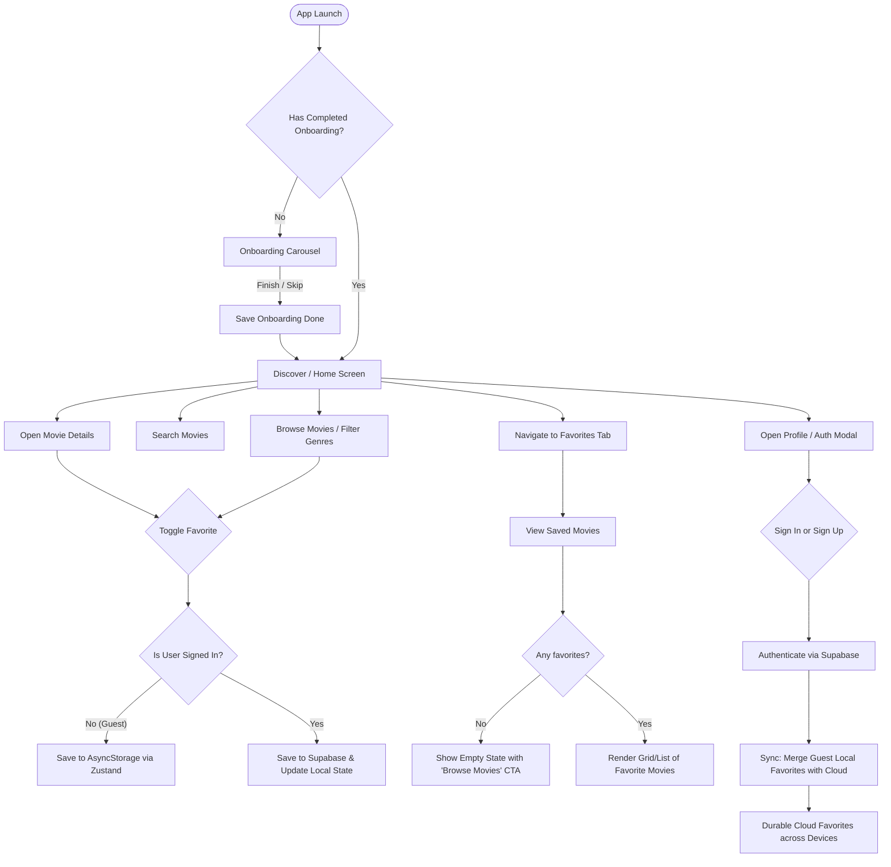

# MovieBox MVP - Project Blueprint

> **Architecture & Product Blueprint**
> Version: 1.0.0
> Tech Stack: Expo SDK 57 (React Native 0.86), Expo Router, Zustand 5, AsyncStorage, Supabase JS, NativeWind / Tailwind CSS

---

## 1. Understand the App

### The Problem
Movie lovers frequently encounter movie recommendations or browse titles on their mobile devices, but most streaming aggregators or apps require an immediate account setup before allowing users to explore or bookmark anything. Conversely, lightweight bookmarking apps often lack cloud sync, stranding favorites when switching devices.

### Audience
- Film enthusiasts, casual moviegoers, and binge-watchers who want quick discovery without sign-up friction.
- Users who value frictionless guest browsing but want their saved watchlist preserved seamlessly across devices once logged in.

### Core Value Proposition
- **Frictionless Discovery**: Zero barrier to entry. Launch the app, skip or view onboarding, immediately explore trending movies, and save favorites straight away.
- **Offline-First & Local Persistence**: Guest users get instant, durable storage on device via AsyncStorage + Zustand.
- **Seamless Cloud Transition**: When a guest decides to sign in or create an account with Supabase, their existing local favorites automatically sync and merge into their personal cloud library, accessible on any device.

### Main Use Cases
1. **Onboarding**: Introduce the app's strengths (discover, bookmark anywhere, sync to cloud) with skip and completion controls.
2. **Catalog Browsing**: Browse trending, top-rated, and categorized cinema titles with rich artwork, ratings, and overviews.
3. **Live Search**: Quickly find titles with real-time query filtering.
4. **Local Favoriting (Guest Mode)**: Tap the heart icon to add/remove movies from personal favorites with zero login required.
5. **Account Management (Supabase Auth)**: Sign up, sign in, or sign out with email/password.
6. **Cloud Sync & Cross-Device Portability**: Sync local favorites to Supabase `favorites` table with Row Level Security (RLS). Sync back when logging in on any device.

---

## 2. Scope Definition

### In Scope (MVP)
- **Onboarding Carousel**: 3 illustrated slides highlighting discovery, instant local favorites, and cloud sync; persist onboarding completion.
- **Movie Catalog & Search**: Rich curated movie database with genre filtering, trending row, top-rated row, and instant title search.
- **Movie Detail View**: Modal/screen showing poster backdrop, release year, rating badge, genre pills, full synopsis, and interactive favorite toggle.
- **Favorites Hub**: Dedicated screen displaying all saved movies, with empty state, quick unfavorite, and account sync status banner.
- **Zustand State Layer**:
  - `useOnboardingStore`: Tracks whether the user has seen onboarding (persisted).
  - `useAuthStore`: Session management, user profile, guest vs signed-in state, auth modal triggers.
  - `useFavoritesStore`: Unified favorites collection, local AsyncStorage persistence, cloud sync merge orchestrator.
- **Supabase Integration**:
  - Auth: Email/password sign-in and sign-up.
  - Database: `favorites` table schema with RLS policies scoped to `auth.uid()`.
  - Resilience: Graceful fallback and clear UI feedback if remote Supabase keys are pending or offline.
- **Platform Polish**: Dark cinematic theme, safe area handling, responsive layout.

### Out of Scope (Future Versions)
- Complex payment/subscription streaming provider deep-links.
- User review comments and social community feeds.
- Push notifications for new releases.
- Full-length movie streaming without a configured video source. Official embedded trailers are supported (see the update below).

---

## 3. User Flows



---

## 4. Screen Plan

| Screen / Modal | Purpose | Key Content & Elements | Primary Actions | States |
| :--- | :--- | :--- | :--- | :--- |
| **Onboarding** (`/onboarding`) | Introduce value and core mechanics | Hero illustrations, step indicators, feature highlights | "Next", "Skip", "Get Started" | Slide 1, 2, 3 |
| **Discover / Home** (`/(tabs)/index`) | Primary browsing hub | Featured Hero Movie, Trending carousel, Top Rated carousel, Category pills | Tap movie card, quick favorite toggle, open search | Loading, Loaded, Error |
| **Search / Explore** (`/(tabs)/explore`) | Search and filter catalog | Search input, genre filter chips, dynamic movie grid | Type query, filter by genre, clear search | Idle, Filtering, Empty results, Results |
| **Favorites** (`/(tabs)/favorites`) | Personal watchlist | Sync status header (Guest badge vs Signed-in badge), movie cards grid | Tap card, remove favorite, tap "Sign In to sync" banner | Empty state, Guest list, Synced list |
| **Movie Detail** (`/movie/[id]`) | Detailed information | High-res backdrop, poster, title, rating, release year, runtime, genre tags, storyline overview | Toggle favorite, back button, share (mock) | Loading, Loaded |
| **Auth / Account Modal** (`/auth`) | Sign in / register / profile management | Toggle Sign In / Sign Up, email input, password input, sign out button, sync status indicator | Submit login, register, sign out, continue as guest | Idle, Submitting, Authenticated, Error banner |

---

## 5. Interface & Design System Tokens (Stitch "Cinematic Editorial")

### Theme: Dark Cinematic Editorial (`#111214` / `#D7A35B`)
- **Cinema Canvas (Background)**: `#111214` (Never pure black; immersive theatrical base)
- **Raised Stage (Cards & Surfaces)**: `#1B1D20` (Movie cards, modals, session cards)
- **Quiet Stage (Inputs & Badges)**: `#25282C` (Search inputs, genre pills, buttons, skeleton bases)
- **Frame Border (Dividers & Borders)**: `#35383C` (1px subtle separators)
- **Primary Ink (Headlines & Main Text)**: `#F5F3EF`
- **Secondary Ink (Subtitles & Metadata)**: `#B2B2B0`
- **Muted Ink (Captions & Indicators)**: `#83868A`
- **Cinema Amber (Sole Accent & Highlights)**: `#D7A35B` (Active favorites, CTAs, spotlight badges, rating stars)

### Typography & Spacing
- Display / Headings: Outfit (600–700)
- Body / Controls: Plus Jakarta Sans / Inter (400–600)
- Numeric & Badges: JetBrains Mono / Courier (500)
- Spacing: 4px grid (`4`, `8`, `12`, `16`, `20`, `24`, `32`, `40`, `48`). Standard screen padding: `20px`.
- Radii: Cards & Posters `16px`, Raised containers `20px`, Inputs & Buttons `14px`, Pills `9999px`.
- Interactive: Minimum 44x44px touch targets; 52px primary action buttons in Cinema Amber.

---

## 6. Data Architecture & Storage Strategy

### A. Movie Data Entity
```typescript
export interface Movie {
  id: string;
  title: string;
  overview: string;
  posterUrl: string;
  backdropUrl: string;
  rating: number; // e.g. 8.4
  releaseYear: number;
  genres: string[];
  durationMinutes: number;
}
```

### B. Zustand Client State Management
1. **`useOnboardingStore`**:
   - `hasCompletedOnboarding: boolean`
   - `completeOnboarding: () => void`
   - Persisted in `@moviebox_onboarding`.
2. **`useAuthStore`**:
   - `user: User | null`
   - `session: Session | null`
   - `isGuest: boolean`
   - `isLoading: boolean`
   - Actions: `signIn`, `signUp`, `signOut`, `continueAsGuest`.
3. **`useFavoritesStore`**:
   - `favorites: Movie[]`
   - `isFavorite: (id: string) => boolean`
   - `toggleFavorite: (movie: Movie) => Promise<void>`
   - `syncWithCloud: (userId: string) => Promise<void>`
   - `clearFavorites: () => void`
   - Persisted locally with `@moviebox_favorites`.

### C. Supabase Cloud Schema & RLS
```sql
-- Table: public.favorites
create table if not exists public.favorites (
  id uuid default gen_random_uuid() primary key,
  user_id uuid references auth.users(id) on delete cascade not null,
  movie_id text not null,
  movie_data jsonb not null,
  created_at timestamp with time zone default timezone('utc'::text, now()) not null,
  unique (user_id, movie_id)
);

-- Row Level Security
alter table public.favorites enable row level security;

create policy "Users can select own favorites"
  on public.favorites for select
  using (auth.uid() = user_id);

create policy "Users can insert own favorites"
  on public.favorites for insert
  with check (auth.uid() = user_id);

create policy "Users can delete own favorites"
  on public.favorites for delete
  using (auth.uid() = user_id);
```

---

## 7. App Architecture & File Layout

```
src/
├── app/
│   ├── _layout.tsx           # Root stack layout (Theme, AuthProvider, Modals)
│   ├── (tabs)/
│   │   ├── _layout.tsx       # Bottom tabs navigation (Discover, Search, Favorites)
│   │   ├── index.tsx         # Discover / Home
│   │   ├── explore.tsx       # Search & Filter
│   │   └── favorites.tsx     # Saved Favorites
│   ├── onboarding.tsx        # Onboarding Carousel screen
│   ├── movie/
│   │   └── [id].tsx          # Movie detail screen
│   └── auth.tsx              # Auth / Account modal
├── components/
│   ├── movie-card.tsx        # Poster card with favorite toggle & rating
│   ├── movie-hero.tsx        # Featured backdrop banner
│   ├── section-header.tsx    # Category & list header
│   ├── favorite-button.tsx   # Animated heart toggle button
│   ├── sync-banner.tsx       # Guest / Synced banner for favorites
│   └── ui/                   # Reusable atomic UI elements
├── data/
│   └── movies.ts             # Curated movie catalog with rich metadata
├── services/
│   ├── supabase.ts           # Supabase client singleton with safe config
│   └── cloud-sync.ts         # Cloud synchronization logic
├── stores/
│   ├── auth-store.ts         # Zustand auth store
│   ├── favorites-store.ts    # Zustand favorites + sync store
│   └── onboarding-store.ts   # Zustand onboarding persistence
└── types/
    └── index.ts              # TypeScript domain types
```

---

## 8. Implementation Steps & Acceptance Criteria

- **Task 1: Project Setup & Domain Layer**: Types, mock movie dataset, Supabase client configuration with safe credentials fallback.
- **Task 2: State Layer**: Zustand stores for Onboarding, Auth, and Favorites (with AsyncStorage persistence and sync orchestrator).
- **Task 3: Onboarding Flow**: Multi-step onboarding carousel with skip, persistent state check, and redirect.
- **Task 4: Movie Browsing & Search**: Discover screen with hero backdrop and categorized rows; Explore screen with live filtering.
- **Task 5: Movie Detail & Favoriting**: Dynamic detail screen (`/movie/[id]`), interactive favorite toggle with optimistic updates.
- **Task 6: Cloud Sync & Favorites Hub**: Favorites tab with guest-mode local indicators, Supabase Auth modal, and automated cloud sync merge.


## Web/mobile Google sign-in and in-app playback update (2026-10-12)

- Google sign-in uses Supabase PKCE with one callback exchange shared by the browser result and Expo Router callback route. Web redirects preserve the configured deployment base path; installed mobile apps use `austinmoviebox://auth-callback`.
- Session restoration starts automatically. Favorites sync runs in the background after local hydration and does not hold the user on the sign-in screen.
- Official trailers play inside the app using the YouTube IFrame API. The native WebView identifies the app through its base URL, while the website uses its real origin. Missing, restricted, or failed trailers have explicit states and retry controls. Playback does not require Google sign-in.
- Full-length movie streams are not supplied by the current TMDB catalog. A separate video source must be specified before adding full-movie playback.
- See `docs/auth-and-playback.md` for exact callback URLs, verification, and outstanding release steps. Earlier blanket QA PASS claims do not establish that these new changes have been tested on physical devices.
