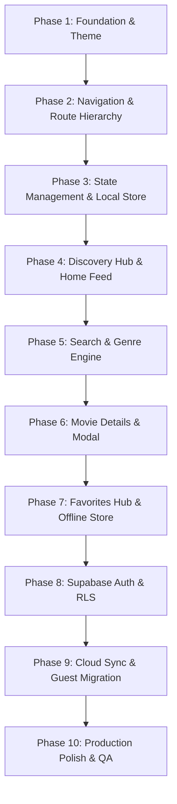

# MovieBox — Phased Implementation Plan (`PLAN.md`)

> **Operating Standard**: Follows [DESIGN.md §64](file:///Users/apple/Downloads/AustinMovieBox/implementation/DESIGN.md#L1851-L1882) (Bounded-Task Iteration Protocol) & [BLUEPRINT.md §8](file:///Users/apple/Downloads/AustinMovieBox/implementation/BLUEPRINT.md#L231-L239).  
> **Development Lifecycle**:  
> $$\text{Understand} \to \text{Specify} \to \text{Design} \to \text{Plan} \to \text{Implement Task} \to \text{Run App} \to \text{Test Acceptance} \to \text{Compare Design} \to \text{Polish} \to \text{Verify Types}$$

---

## 📌 Phase Overview & Milestone Roadmap

---

## 🛠️ Phase 1: Foundation, Design Tokens & Global Layout
- **Objective**: Establish the dark cinematic visual foundation, design tokens, typography, and responsive container structure.
- **Key Deliverables**:
  - `src/theme/tokens.ts`: Defined colors (`#08090D`, `#141923`, `#202736`, `#E50914`, `#F5C518`), typography scale, 4px grid spacing, and radii.
  - `src/theme/index.ts`: Central export of theme values and helper functions.
  - `tailwind.config.js` & `src/global.css`: NativeWind v4 configuration supporting cinematic dark mode classes.
  - `src/types/index.ts`: Standardized Movie, UserProfile, Genre, and Filter interfaces.
- **Acceptance Criteria**:
  - [x] Zero bright or light mode fallbacks; canvas background locked to `#08090D`.
  - [x] TypeScript compiles without missing type definitions.

---

## 🧭 Phase 2: Navigation Architecture & Route Hierarchy
- **Objective**: Configure Expo Router layout with root stack and 4-tab persistent bottom navigation.
- **Key Deliverables**:
  - `src/app/_layout.tsx`: Root Stack provider with StatusBar, safe area, and session boot.
  - `src/app/(tabs)/_layout.tsx`: 4 persistent tabs (Home, Search, Favorites, Profile) with SF Symbols / IonIcons and custom tab styling.
  - Screen placeholders: `index.tsx` (Home), `search.tsx` (Search), `favorites.tsx` (Favorites), `profile.tsx` (Profile).
  - Modal route: `src/app/movie/[id].tsx` (Movie Details modal/screen) and `src/app/auth.tsx` (Auth sheet).
  - Onboarding route: `src/app/onboarding.tsx`.
- **Acceptance Criteria**:
  - [x] Smooth tab switching with active red accent indicator.
  - [x] Nested routing preserves history without jarring re-renders.

---

## 📦 Phase 3: Zustand State Management & Local Persistence
- **Objective**: Build clean, decoupled reactive stores with AsyncStorage persistence.
- **Key Deliverables**:
  - `src/stores/onboarding-store.ts`: Tracks `hasCompletedOnboarding` with `@moviebox_onboarding`.
  - `src/stores/auth-store.ts`: Tracks `user`, `session`, `isGuest`, and `isLoading`.
  - `src/stores/favorites-store.ts`: Manages `favorites: Movie[]`, local hydration via `@moviebox_favorites`, add/remove/toggle methods.
- **Acceptance Criteria**:
  - [x] Stores hydrate from AsyncStorage on initial launch.
  - [x] State transitions do not trigger unnecessary re-renders.

---

## 🎬 Phase 4: Discovery Hub & Home Feed
- **Objective**: Implement the primary browsing feed with featured hero banner and horizontal movie rails.
- **Key Deliverables**:
  - `src/data/movies.ts`: Curated movie database with high-resolution posters, backdrops, ratings, synopsis, and genres.
  - `src/components/movie-hero.tsx`: Featured movie banner with gradient scrim overlay, rating badge, and quick CTA buttons ("View Details", "Favorite").
  - `src/components/movie-card.tsx`: Reusable 2:3 aspect ratio card with rating overlay and smooth pressable states.
  - `src/components/movie-rail.tsx`: Horizontally scrollable section with section header and card list.
  - `src/app/(tabs)/index.tsx`: Composite Home screen integrating Hero, Trending rail, Popular rail, and Top Rated rail.
- **Acceptance Criteria**:
  - [x] Poster cards maintain strict 2:3 aspect ratio without stretching.
  - [x] Hero gradient blends seamlessly into `#08090D` background.

---

## 🔍 Phase 5: Search & Genre Filtering Engine
- **Objective**: Build an instant search and genre-based exploration interface.
- **Key Deliverables**:
  - `src/app/(tabs)/search.tsx`: Search bar with clear button, horizontal genre chip selector, and 2-column results grid.
  - Real-time search query matching across title, overview, and cast tags.
  - Empty state when no titles match query, with "Clear Filters" CTA.
- **Acceptance Criteria**:
  - [x] Instant query responsiveness.
  - [x] Genre filter toggles dynamically update the movie grid.

---

## 🎟️ Phase 6: Movie Details Modal View
- **Objective**: Deliver a comprehensive movie details experience with interactive favoriting.
- **Key Deliverables**:
  - `src/app/movie/[id].tsx`: Fullscreen / modal details screen with backdrop header, back button, share icon, runtime, release year, rating, genre pills, full synopsis, and director/cast metadata.
  - `src/components/favorite-button.tsx`: Heart toggle with instantaneous state update and visual feedback.
- **Acceptance Criteria**:
  - [x] Tapping any movie from Home, Search, or Favorites opens its detail view.
  - [x] Toggling favorite button updates both details screen and global store immediately.

---

## ❤️ Phase 7: Favorites Hub & Offline Guest Persistence
- **Objective**: Build the dedicated Favorites tab with empty state and guest banner.
- **Key Deliverables**:
  - `src/app/(tabs)/favorites.tsx`: 2-column grid of saved movies with quick remove action.
  - `src/components/empty-state.tsx`: Illustrated empty state with "Discover Movies" CTA when no favorites exist.
  - `src/components/sync-banner.tsx`: Guest banner ("Save favorites across devices — Sign in or create an account") that routes to Auth.
- **Acceptance Criteria**:
  - [x] Guest users can add and remove favorites with zero login required.
  - [x] Favorites persist across complete app reloads and process restarts.

---

## 🔐 Phase 8: Supabase Auth & Cloud Database Setup
- **Objective**: Implement Supabase authentication and PostgreSQL database with Row Level Security.
- **Key Deliverables**:
  - `src/services/supabase.ts`: Supabase client initialization with AsyncStorage session adapter and offline fallback.
  - `src/app/auth.tsx`: Auth screen supporting Email/Password Sign In and Sign Up with validation and error alerts.
  - `src/app/(tabs)/profile.tsx`: Profile screen displaying user email, account status, sync indicator, and Sign Out button.
  - SQL Schema: `public.favorites` table with RLS policies (`auth.uid() = user_id`).
- **Acceptance Criteria**:
  - [x] Seamless user sign-in and sign-up with real-time auth state updates.
  - [x] Graceful fallback to guest mode if Supabase credentials are not configured.

---

## 🔄 Phase 9: Non-Destructive Cloud Sync & Guest Migration
- **Objective**: Ensure guest favorites are merged non-destructively upon sign-in.
- **Key Deliverables**:
  - `src/services/cloud-sync.ts`: Non-destructive sync logic calculating $Local \cup Cloud$ deduplicated by `movie_id`.
  - Batch insertion of local-only favorites into Supabase `public.favorites`.
  - Bidirectional sync updating local Zustand store with remote items.
- **Acceptance Criteria**:
  - [x] Local guest favorites are never wiped when logging into an account.
  - [x] Existing cloud favorites are never overwritten or deleted during migration.

---

## 💎 Phase 10: Production Polish & Quality Assurance
- **Objective**: Verify all MVP Quality Bar requirements ([DESIGN.md §65](file:///Users/apple/Downloads/AustinMovieBox/implementation/DESIGN.md#L1885-L1905)).
- **Key Deliverables**:
  - Onboarding 3-step carousel with skip and completion persistence (`src/app/onboarding.tsx`).
  - Skeleton loading states and image placeholders (`expo-image`).
  - Haptic feedback integration (`expo-haptics`).
  - Full TypeScript type-safety (`npx tsc --noEmit`).
- **Acceptance Criteria**:
  - [x] Passes TypeScript check with 0 errors.
  - [x] Zero unhandled exceptions or broken views.
